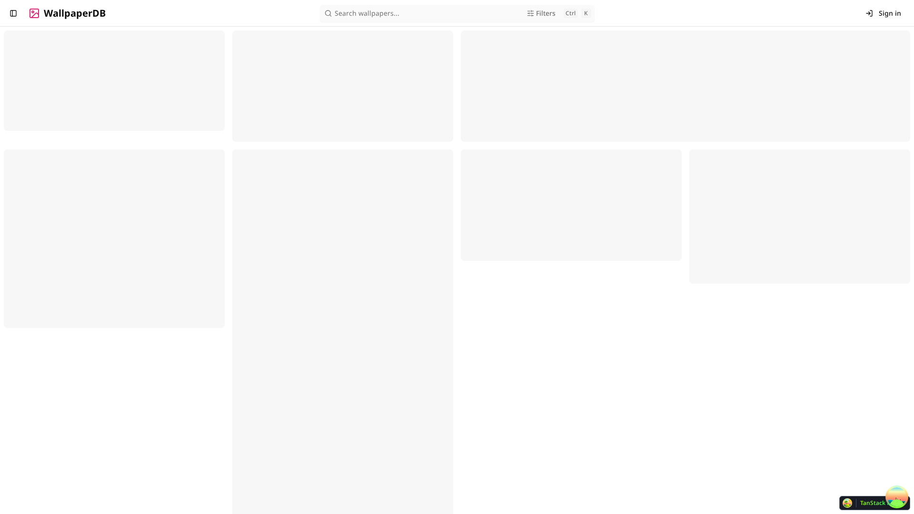

# WallpaperDB

WallpaperDB lets people upload, discover, and download wallpapers, with contributor Profiles and images sized for different devices.

## Start here

- [Understand domain ownership and service relationships](GLOSSARY-MAP.md).
- [Read the coding guidelines](CODING_STANDARDS.md) or [agent workflow rules](AGENTS.md).
- [Read architecture decisions](docs/adr/).

Workspace READMEs explain their purpose, core capabilities, and relevant technology choices. Use the source, tests, schemas, and `make help` for implementation and command details.

## Core capabilities

- Upload wallpapers, filter discovery by contributor, format, and aspect ratio, and rank results by color preference.
- Retrieve original images and renditions sized for different devices.
- Manage public contributor Profiles with Handles, Biographies, and pictures.
