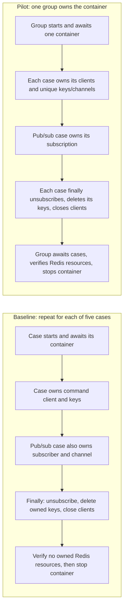

# Throwaway Redis fixture prototype

This draft answers [issue #435](https://github.com/rafaeltab/wallpaperdb/issues/435): does one group-owned Redis container simplify repeated lifecycle work while preserving case isolation? Adoption requires a separate decision. Default tests, Make/Turbo/CI behavior, and the production test-builder API stay unchanged.

Run from the repository root with Docker available. These commands share the repository's Docker validation lock.

```sh
# Complete opt-in prototype, including the matched comparison.
flock -w 900 /tmp/wallpaperdb-perf-validation.lock \
  make prototype-redis

# Find retained measurements if Vitest suppresses successful console output.
ls -t /tmp/wallpaperdb-redis-prototype-*/samples.json

# Run the assertion-failure and overlapping-ownership demonstration alone.
flock -w 900 /tmp/wallpaperdb-perf-validation.lock \
  make prototype-redis ARGS='-t "cleans a failed case"'

# Unchanged original Redis suite, including its independent contracts.
flock -w 900 /tmp/wallpaperdb-perf-validation.lock \
  make test-focused PACKAGE=test-utils ARGS='tests/redis.test.ts'
```

The opt-in command and its configuration are defined in the [Makefile](../../../Makefile) and [prototype config](vitest.config.ts). Additional Vitest filters pass through `ARGS`.

## Scope and ownership

The pilot covers SET/GET, hashes, lists, expiration, and pub/sub from the [original suite](../tests/redis.test.ts). Both measured approaches execute the same operation assertions with unique case keys/channels and bounded polling for expiration and message delivery. Only container ownership changes.

The measured baseline adapts those five cases to the same scoped cleanup and bounded observations as the pilot. The unchanged original suite runs separately as compatibility validation with its existing keys, waits, and retry policy.



[fixture.ts](fixture.ts) contains the sample owner. Case cleanup attempts every release even if another release fails. One deadline covers each case's unsubscribe, key deletion, and client closure. Group shutdown has a shared deadline for pending cases and Redis verification. A stalled graceful QUIT ends with forced disconnection. A pending-case timeout aborts fixture access and forces existing clients closed.

On normal completion, group teardown checks key absence, subscription counts, and named Redis clients before stopping the container, then checks Docker for container removal. A failed teardown preserves its errors and still attempts container removal; it does not count that removal as proof that the Redis audit passed. Shared cases must never call `withRedisAutoCleanup()`, which executes `FLUSHALL`.

Creation/readiness, custom image/configuration, network/alias, endpoints, destruction, and pre-setup/error contracts retain their independent fixtures in the original suite. OpenSearch, network restoration, Ryuk regressions, and Docker endpoint portability are outside this pilot.

## Validation and measurement

[comparison.test.ts](comparison.test.ts) demonstrates independent execution, reordered cases, overlapping ownership, and cleanup after an intentional assertion failure. The overlapping survivor must keep its data and subscription after the failed case releases its own resources. Cleanup checks run before container teardown so stopping Redis cannot hide a leak.

[shutdown.test.ts](shutdown.test.ts) covers a stuck callback, late resource acquisition, and real Redis sockets stalled during QUIT, DEL, unsubscribe, or observer verification. These cases must report failure and remove their container within the test deadline.

The comparison uses one warmup group and five alternating baseline/pilot pairs. Each pair runs the five operations serially. Both approaches use the same cached image, one worker, concurrency one, disabled coverage, and zero retries. The unchanged original suite is separate validation and retains its existing configuration.

Each measurement run retains raw JSON in a private `/tmp/wallpaperdb-redis-prototype-*/samples.json` file, including failed samples. The test emits its path; Vitest may suppress successful console output. Startup/readiness, client setup, operation body, scoped cleanup, verification, container cleanup, and total elapsed time are separate measurements. Expected lifecycle counts per successful sample are five starts/stops for baseline and one start/stop for pilot.

Total elapsed time includes verification. `elapsedWithoutVerificationMs` subtracts the measured Redis and Docker audit time, since baseline audits five groups and pilot audits one. Client setup measures the command client; the pub/sub subscriber connects inside the operation body in both modes. Overlap and failure demonstrations are separate from the serial timing samples.

The [raw samples](evidence/samples.json) and [derived summary](evidence/summary.json) record a fresh run after the teardown fixes, measured at `2026-10-21T17:02:04.954Z` on a local Linux Docker host with Node 22.22.3. Both baseline and pilot used the fixed code at `3b117d1deb18a8b50534c21228ca7bd977db136d`. Every sample passed. The cached image ID before and after measurement was `sha256:6ab0b6e7381779332f97b8ca76193e45b0756f38d4c0dcda72dbb3c32061ab99`. The recorded source hash `570ad27a1bd1595bf84254f768966a94004c7867b5115b5ad1d29244d2cfbe36` matches the committed runnable files. These timings compare container ownership within that version of the code.

Medians per five-case sample, in milliseconds:

| Measurement | Baseline | Pilot |
| --- | --- | --- |
| Observed starts / stops / removed containers | 5 / 5 / 5 | 1 / 1 / 1 |
| Closed case clients | 6 | 6 |
| Startup/readiness | 500.69 | 94.43 |
| Command client setup | 5.21 | 4.27 |
| Operation body | 1030.24 | 1025.52 |
| Scoped case cleanup | 1.64 | 2.01 |
| Container cleanup | 1097.00 | 232.82 |
| Redis/Docker verification | 338.80 | 75.99 |
| Total elapsed | 2969.02 | 1433.00 |
| Elapsed excluding verification | 2632.50 | 1357.32 |
| Failed samples / retained samples | 0 / 5 | 0 / 5 |

The pilot's median total was 1536.02 ms lower, or 51.73%. Excluding verification, it was 1275.18 ms lower, or 48.44%. These are differences between medians; the raw record preserves every pair and its order. The operation body still costs about one second, mostly the specified expiration check.

| Pair | Order | Baseline total, ms | Pilot total, ms |
| --- | --- | --- | --- |
| 1 | Baseline, pilot | 2939.48 | 1441.62 |
| 2 | Pilot, baseline | 2969.02 | 1430.73 |
| 3 | Baseline, pilot | 2959.90 | 1433.00 |
| 4 | Pilot, baseline | 3025.81 | 1429.33 |
| 5 | Baseline, pilot | 3007.77 | 1454.47 |

Runtime validation after the teardown fixes passed all 14 opt-in tests and the unchanged original suite with 12 passes and its two existing network-related skips. Final local `make ci` passed all 96 tasks in 253 seconds. See the [validation record](evidence/validation.json) for validation provenance. This Docker fixture has no browser UI; its runtime evidence is command output and Redis/Docker assertions.

## Risks and recommendation

Shared Redis makes a global command, unscoped key deletion, leaked subscription, or container failure affect other cases. The prototype adds ownership bookkeeping and cleanup verification to constrain those risks. Its evidence covers these five operation cases, not all Redis tests or hosted CI.

An arbitrary JavaScript callback can continue running after the fixture stops waiting for it. Shutdown blocks later fixture resource acquisition and reopening of retained fixture clients, then closes existing clients and removes the container. The fixture cannot cancel unrelated work started by a callback.

The experiment has 338 lines of fixture code, 48 lines of shared operations, 71 lines of isolation demonstrations, 99 lines of shutdown demonstrations, 104 lines of measurement code, and 15 lines of runner configuration. The fixture needs a group owner, case registration, exact resource tracking, cancellation guards, and `finally` cleanup. That cost needs review alongside the saved container lifecycles.

Keep the draft opt-in for lifecycle and API review. The measurements support further evaluation of reuse for these five cases. Adoption requires a separate decision. Local savings do not establish a shorter PR wait time or show that the whole hosted container-test phase can be removed. The issue's hosted sample measured a 125.1-second container phase inside a 154-second job, already shorter than the 480-second main job; the whole phase is not removable lifecycle overhead.
