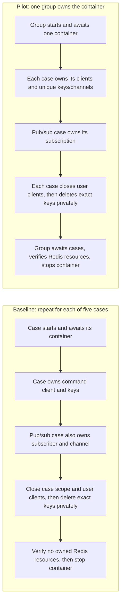

# Throwaway Redis fixture prototype

This draft answers [issue #435](https://github.com/rafaeltab/wallpaperdb/issues/435): does one group-owned Redis container simplify repeated lifecycle work while preserving case isolation? Adoption requires a separate decision. Default tests, Make/Turbo/CI behavior, and the production test-builder API stay unchanged.

Run from the repository root with Docker available. These commands share the repository's Docker validation lock.

```sh
# Complete opt-in prototype, including the matched comparison.
flock -w 900 /tmp/wallpaperdb-perf-validation.lock \
  make prototype-redis

# Find retained measurements if Vitest suppresses successful console output.
ls -t /tmp/wallpaperdb-redis-prototype-*/samples.json

# Run the assertion-failure and overlapping-ownership demonstration alone.
flock -w 900 /tmp/wallpaperdb-perf-validation.lock \
  make prototype-redis ARGS='-t "cleans a failed case"'

# Unchanged original Redis suite, including its independent contracts.
flock -w 900 /tmp/wallpaperdb-perf-validation.lock \
  make test-focused PACKAGE=test-utils ARGS='tests/redis.test.ts'
```

The opt-in command and its configuration are defined in the [Makefile](../../../Makefile) and [prototype config](vitest.config.ts). Additional Vitest filters pass through `ARGS`.

## Scope and ownership

The pilot covers SET/GET, hashes, lists, expiration, and pub/sub from the [original suite](../tests/redis.test.ts). Both measured approaches execute the same operation assertions with unique case keys/channels and bounded polling for expiration and message delivery. Only container ownership changes.

The measured baseline adapts those five cases to the same scoped cleanup and bounded observations as the pilot. The unchanged original suite runs separately as compatibility validation with its existing keys, waits, and retry policy.



[fixture.ts](fixture.ts) contains the sample owner. A case closes its scope before cleanup starts. Retained callbacks cannot acquire fixture resources or reopen clients after that case ends. A late subscription acknowledgment rejects, and its listener drops later delivery. Cleanup unsubscribes, closes every user connection, then deletes exact owned keys through a private cleanup connection. Closing user connections before the final deletion prevents a detached raw SET from restoring an owned key during retirement. Active peers keep their own data and subscriptions.

One deadline covers a case's unsubscribe, user connection closure, private deletion connection setup, exact DEL, and private connection closure. Group shutdown caps that deadline with its own Redis deadline. Once it expires, cleanup starts no new graceful Redis operations and cancels all owned native transports before waiting for aggregate settlement. Native socket cancellation also covers a connection whose Redis socket assignment has not completed. Earlier callback and cleanup errors remain observable.

Group shutdown fixes one aggregate deadline at entry. It allows the configured Redis window, then five seconds of Docker grace. Stopping reserves 2.5 seconds for removal and verification; removal reserves the final 500 ms for verification. Docker calls use actual HTTP AbortSignals through the runtime selected by Testcontainers. Each stage preserves earlier errors and attempts the next stage.

On normal completion, the group audits keys, subscriptions, and named Redis clients before stopping Redis, then verifies container removal. On failure it force-closes clients and attempts owned-container removal. An unavailable daemon can prevent removal; the returned errors identify the owned container and the failed Docker operation. Container removal does not prove that an earlier Redis audit passed. Shared cases must never call `withRedisAutoCleanup()`, which executes `FLUSHALL`.

Creation/readiness, custom image/configuration, network/alias, endpoints, destruction, and pre-setup/error contracts retain their independent fixtures in the original suite. OpenSearch, network restoration, Ryuk regressions, and Docker endpoint portability are outside this pilot.

## Validation and measurement

[comparison.test.ts](comparison.test.ts) demonstrates independent execution, reordered cases, overlapping ownership, and cleanup after an intentional assertion failure. The overlapping survivor must keep its data and subscription after the failed case releases its own resources. Cleanup checks run before container teardown so stopping Redis cannot hide a leak.

[shutdown.test.ts](shutdown.test.ts) covers finished case scopes, detached subscription acquisition, a stuck callback, and real Redis sockets stalled during QUIT, unsubscribe, or observer verification. [docker-shutdown.test.ts](docker-shutdown.test.ts) stalls actual HTTP stop/removal requests and an incomplete list response. These tests check cancellation, continued cleanup, preserved Redis errors, closed sockets, and actual removal on a healthy daemon.

[retirement.test.ts](retirement.test.ts) checks exact key deletion after user disconnection or a detached raw SET, active peer isolation, and a stalled private cleanup DEL. [subscription-retirement.test.ts](subscription-retirement.test.ts) holds subscription completion after a real acknowledgment and checks rejection and suppressed late delivery. [expired-budget.test.ts](expired-budget.test.ts) uses a stateful adapter with two and 32 subscriptions to check aggregate retirement after deadline expiry. [delayed-connect.test.ts](delayed-connect.test.ts) uses a real TCP proxy to check transport cancellation before Redis stores a connecting socket.

The comparison uses one warmup group and five alternating baseline/pilot pairs. Each pair runs the five operations serially. Both approaches use the same cached image, one worker, concurrency one, disabled coverage, and zero retries. The unchanged original suite is separate validation and retains its existing configuration.

Each measurement run retains raw JSON in a private `/tmp/wallpaperdb-redis-prototype-*/samples.json` file, including failed samples. The test emits its path; Vitest may suppress successful console output. Startup/readiness, client setup, operation body, scoped cleanup, verification, container cleanup, and total elapsed time are separate measurements. Expected lifecycle counts per successful sample are five starts/stops for baseline and one start/stop for pilot.

Total elapsed time includes verification. `elapsedWithoutVerificationMs` subtracts the measured Redis and Docker audit time, since baseline audits five groups and pilot audits one. Client setup measures the case command client; the pub/sub subscriber connects inside the operation body in both modes. Private deletion connection setup is part of scoped cleanup. Each successful five-case sample closes six user clients and five private deletion clients, equally in baseline and pilot. Overlap and failure demonstrations are separate from the serial timing samples.

The [raw samples](evidence/samples.json) and [derived summary](evidence/summary.json) record a fresh run after the case retirement fixes, measured at `2026-10-21T18:32:07.912Z` on a local Linux Docker host with Node 22.22.3. Both baseline and pilot used the same fixed code at `4872ad2081a42986c5f27c362ed582ddb872e8c8`. Every sample passed. The cached image ID before and after measurement was `sha256:6ab0b6e7381779332f97b8ca76193e45b0756f38d4c0dcda72dbb3c32061ab99`. The source hash `89c60508244fd8d87b48a02d30da573e5c0abbf66b05f1c99f68173b3cc3f47b` matches the committed runnable files. These timings compare container ownership within that version of the code.

Medians per five-case sample, in milliseconds:

| Measurement | Baseline | Pilot |
| --- | --- | --- |
| Observed starts / stops / removed containers | 5 / 5 / 5 | 1 / 1 / 1 |
| Closed clients, six user plus five private deletion | 11 | 11 |
| Startup/readiness | 484.65 | 98.31 |
| Command client setup | 6.02 | 3.40 |
| Operation body | 1033.07 | 1040.08 |
| Scoped case cleanup | 8.14 | 8.59 |
| Container cleanup | 1082.64 | 223.92 |
| Redis/Docker verification | 351.97 | 80.10 |
| Total elapsed | 2976.06 | 1451.56 |
| Elapsed excluding verification | 2628.19 | 1372.70 |
| Failed samples / retained samples | 0 / 5 | 0 / 5 |

The pilot's median total was 1524.51 ms lower, or 51.23%. Excluding verification, it was 1255.49 ms lower, or 47.77%. These are differences between medians; the raw record preserves every pair and its order. The operation body still includes the specified expiration check.

| Pair | Order | Baseline total, ms | Pilot total, ms |
| --- | --- | --- | --- |
| 1 | Baseline, pilot | 2950.40 | 1423.05 |
| 2 | Pilot, baseline | 2976.06 | 1466.82 |
| 3 | Baseline, pilot | 2951.54 | 1428.21 |
| 4 | Pilot, baseline | 2982.86 | 1453.11 |
| 5 | Baseline, pilot | 3000.60 | 1451.56 |

Runtime validation ran 26 regression tests plus one separately selected measurement test. All 27 passed. The unchanged original Redis suite passed 12 tests with its two existing network-related skips. Final local `make ci` passed all 96 tasks in 252 seconds. See the [validation record](evidence/validation.json) for current results and historical regression provenance. This Docker fixture has no browser UI; its runtime evidence is command output and Redis/Docker assertions.

Historical measurements at `2ac99ddb7406a8c17a693a8fa0e1470640d5ae67` used source hash `2b7d0157aa3d2b45d290c89bad0aa9676219ec183caa968934d2cc958f8dce30` and closed six user clients per sample. Their baseline and pilot median totals were 2982.65 ms and 1427.01 ms. The validation record preserves that source-bound summary and its published raw report identity. The current table uses the retirement implementation with eleven clients per sample. Each run compares baseline and pilot within its own source version; the historical totals do not measure the speed of the retirement fixes.

## Risks and recommendation

Shared Redis makes a global command, unscoped key deletion, leaked subscription, or container failure affect other cases. The prototype adds ownership bookkeeping and cleanup verification to constrain those risks. Its evidence covers these five operation cases, not all Redis tests or hosted CI.

An arbitrary JavaScript callback can continue after the fixture stops waiting for it. Case and group closure block later fixture resource acquisition and reopening of retained fixture clients. Retirement closes user connections before exact private deletion. Expired budgets trigger transport cancellation and preserve cleanup errors. The fixture cannot cancel unrelated callback work or guarantee container removal while the Docker daemon is unavailable.

The experiment has 441 lines of fixture code, 48 lines of shared operations, 1080 lines of correctness controls across seven files, 105 lines of measurement code, and 15 lines of runner configuration. The fixture needs case and group ownership, exact resource tracking, cancellation guards, native transport and HTTP request cancellation, and cleanup budgets. That cost needs review alongside the saved container lifecycles.

Keep the draft opt-in for lifecycle and API review. The measurements support further evaluation of reuse for these five cases. Adoption requires a separate decision. Local savings do not establish a shorter PR wait time or show that the whole hosted container-test phase can be removed. The issue's hosted sample measured a 125.1-second container phase inside a 154-second job, already shorter than the 480-second main job; the whole phase is not removable lifecycle overhead.
